# Expense Tracker

A full-stack web application for managing personal expenses. The application provides a RESTful backend built with **Node.js and Express**, uses **PostgreSQL** for persistent data storage, and provides a responsive frontend built with **HTML, CSS, Vanilla JavaScript, and Bootstrap 5.3.8**.

Users can add, edit, delete, search, filter, sort, and export expenses while viewing summary statistics such as the total amount, number of expenses, and highest expense.

---

## Table of Contents

* [Project Overview](#project-overview)
* [Features](#features)
* [Tech Stack](#tech-stack)
* [Project Structure](#project-structure)
* [Getting Started](#getting-started)

  * [Prerequisites](#1-prerequisites)
  * [Clone the Repository](#2-clone-the-repository)
  * [Create the Database](#3-create-the-database)
  * [Run schema.sql](#4-run-schemasql)
  * [Configure Environment Variables](#5-configure-environment-variables)
  * [Install Backend Packages](#6-install-backend-packages)
  * [Start the Backend Server](#7-start-the-backend-server)
  * [Run the Frontend](#8-run-the-frontend)
* [How the Application Works](#how-the-application-works)
* [API Reference](#api-reference)
* [Validation Rules](#validation-rules)
* [Frontend Behavior](#frontend-behavior)
* [CSV Export](#csv-export)
* [Dark Mode](#dark-mode)
* [Testing](#testing)
* [Screenshots](#screenshots)
* [Challenges and Lessons Learned](#challenges-and-lessons-learned)
* [Security and Good Practices](#security-and-good-practices)
* [Future Improvements](#future-improvements)
* [Project Links](#project-links)

---

# Project Overview

Expense Tracker is a full-stack application developed in two main parts:

### Backend — Phase 1

The backend provides a REST API using **Express.js** and **PostgreSQL**.

It is responsible for:

* Storing expenses in PostgreSQL.
* Creating, reading, updating, and deleting expenses.
* Validating incoming data.
* Returning consistent JSON responses.
* Using parameterized SQL queries.
* Handling invalid IDs and invalid request data.
* Enabling CORS so the frontend can communicate with the API.

### Frontend — Phase 2

The frontend communicates directly with the backend API using the browser `fetch()` API and `async/await`.

It provides:

* Expense summary cards.
* Add expense form.
* Edit expense modal.
* Delete confirmation modal.
* Search.
* Category filtering.
* Month filtering.
* Table sorting.
* CSV export.
* Dark/light mode.
* Loading spinners.
* Success notifications.
* Error alerts.
* Responsive design.

The frontend does **not** use hard-coded sample data, in-memory storage, or `localStorage` for expenses. The database is the source of truth.

---

# Features

## Backend Features

* [x] RESTful API built with Express.
* [x] PostgreSQL database integration.
* [x] Get all expenses.
* [x] Get one expense by ID.
* [x] Create an expense.
* [x] Update an expense.
* [x] Delete an expense.
* [x] Server-side validation.
* [x] Positive integer ID validation.
* [x] Parameterized SQL queries.
* [x] `RETURNING` used for inserted, updated, and deleted records.
* [x] CORS enabled.
* [x] JSON request and response handling.
* [x] PostgreSQL `NUMERIC` values converted to JavaScript numbers.
* [x] PostgreSQL dates returned as `YYYY-MM-DD`.
* [x] Appropriate HTTP status codes.
* [x] Error handling for database/server failures.

## Frontend Features

* [x] Responsive Bootstrap interface.
* [x] Summary cards:

  * Total amount.
  * Number of expenses.
  * Highest expense.
* [x] Add expense.
* [x] Edit expense.
* [x] Delete expense with confirmation.
* [x] Client-side form validation.
* [x] Server-side validation errors displayed to the user.
* [x] Search expenses by title.
* [x] Filter by category.
* [x] Filter by month.
* [x] Clear filters.
* [x] Sort by title, amount, category, and date.
* [x] CSV export.
* [x] Export respects the current filters.
* [x] Loading spinner while requests are running.
* [x] Buttons are disabled during requests to prevent duplicate submissions.
* [x] Success toast notifications.
* [x] Bootstrap error alerts.
* [x] Backend connection error handling.
* [x] Dark/light mode.
* [x] Responsive table with horizontal scrolling on small screens.
* [x] Table rows generated dynamically using the DOM.
* [x] User input inserted using `textContent` rather than `innerHTML`.
* [x] After add, edit, or delete, the frontend refreshes data from the server.

---

# Tech Stack

| Layer                       | Technology             |
| --------------------------- | ---------------------- |
| Database                    | PostgreSQL             |
| Backend                     | Node.js                |
| API Framework               | Express.js             |
| Database Driver             | `pg`                   |
| CORS                        | `cors`                 |
| Environment Variables       | `dotenv`               |
| Frontend                    | HTML5                  |
| Styling                     | CSS3 + Bootstrap 5.3.8 |
| Frontend Logic              | Vanilla JavaScript     |
| API Communication           | Fetch API              |
| Asynchronous Operations     | `async/await`          |
| Database Management         | pgAdmin                |
| API Testing                 | Thunder Client         |
| Development Environment     | Visual Studio Code     |
| Frontend Development Server | VS Code Live Server    |

---

# Project Structure

```text
expense-tracker-web-application/
│
├── backend/
│   ├── server.js
│   ├── schema.sql
│   ├── .env.example
│   ├── package.json
│   └── test-images/
│       ├── get-all-expenses-test-images/
│       ├── get-by-id-test-images/
│       ├── post-test-images/
│       ├── put-test-images/
│       └── delete-test-images/
│
├── frontend/
│   ├── index.html
│   ├── css/
│   │   └── style.css
│   ├── js/
│   │   └── app.js
│   └── screenshots/
│       ├── desktop.png
│       ├── mobile.png
│       ├── update-modal.png
│       ├── delete-modal.png
│       └── error-state.png
│
└── README.md
```

---

# Getting Started

Follow the steps below to run the complete project from a clean installation.

## 1. Prerequisites

Make sure the following are installed:

* **Node.js**
* **npm**
* **PostgreSQL**
* **pgAdmin** or another PostgreSQL client
* **Visual Studio Code**
* **Live Server** extension for VS Code
* **Thunder Client** extension for VS Code (optional, for API testing)

You can verify Node.js and npm with:

```bash
node --version
npm --version
```

---

## 2. Clone the Repository

Clone the project from GitHub:

```bash
git clone https://github.com/HashemQuraan-402/expense-tracker-web-application.git
```

Then enter the project directory:

```bash
cd expense-tracker-web-application
```

---

## 3. Create the Database

Open **PostgreSQL / pgAdmin**.

Create a new database named:

```text
expense_tracker
```

The database name must match the following environment variable:

```env
DB_NAME=expense_tracker
```

---

## 4. Run `schema.sql`

Open:

```text
backend/schema.sql
```

The schema creates the `expenses` table and inserts the initial sample data.

Run the complete file in the PostgreSQL Query Tool.

The database table contains:

| Column     | Type          | Description                         |
| ---------- | ------------- | ----------------------------------- |
| `id`       | SERIAL        | Automatically generated primary key |
| `title`    | VARCHAR(100)  | Expense title                       |
| `amount`   | NUMERIC(10,2) | Expense amount                      |
| `category` | VARCHAR(20)   | Expense category                    |
| `date`     | DATE          | Expense date                        |

The available categories are:

```text
Food
Transport
Bills
Entertainment
Other
```

### Resetting the Database

Running `schema.sql` again will:

1. Delete the existing `expenses` table.
2. Recreate it.
3. Insert the original sample expenses again.

This makes it useful for testing the application from a clean state.

---

## 5. Configure Environment Variables

Inside the `backend` directory, create a file named:

```text
.env
```

You can use `.env.example` as the template.

Example:

```env
DB_HOST=localhost
DB_PORT=5432
DB_USER=postgres
DB_PASSWORD=your_postgresql_password
DB_NAME=expense_tracker
```

Replace:

```text
your_postgresql_password
```

with the password of your PostgreSQL user.

### Important

Do **not** commit `.env` to GitHub.

The `.env` file contains database credentials and should remain private.

---

## 6. Install Backend Packages

Open a terminal in the `backend` directory:

```bash
cd backend
```

If the project already contains `package.json`, install the dependencies with:

```bash
npm install
```

The project uses:

```text
express
cors
pg
dotenv
```

If installing the packages manually:

```bash
npm install express cors pg dotenv
```

---

## 7. Start the Backend Server

From the `backend` directory:

```bash
node server.js
```

The Express server runs on:

```text
http://localhost:3000
```

The main API endpoint is:

```text
http://localhost:3000/api/expenses
```

Keep the backend terminal running while using the frontend.

If `server.js` is changed, restart the server:

```text
Ctrl + C
```

then:

```bash
node server.js
```

---

## 8. Run the Frontend

Open the project in **Visual Studio Code**.

Open:

```text
frontend/index.html
```

Then right-click the file and choose:

```text
Open with Live Server
```

The frontend will normally open at an address similar to:

```text
http://127.0.0.1:5500/
```

The exact port may be different depending on the Live Server configuration.

The frontend communicates with:

```text
http://localhost:3000/api/expenses
```

This URL is configured at the beginning of:

```text
frontend/js/app.js
```

```javascript
const API_URL = "http://localhost:3000/api/expenses";
```

Both the frontend and backend need to be running for the application to work correctly.

---

# How the Application Works

The overall flow is:

```text
                    PostgreSQL
                        ▲
                        │
                     pg Pool
                        │
                        ▼
                 Express REST API
                  localhost:3000
                        ▲
                        │
                    fetch()
                        │
                        ▼
              Frontend JavaScript
                        │
                        ▼
                  Bootstrap UI
```

For example, when the page loads:

```text
Browser
   ↓
GET /api/expenses
   ↓
Express
   ↓
PostgreSQL
   ↓
JSON response
   ↓
JavaScript
   ↓
Render table + summary
```

When a user adds an expense:

```text
Form
  ↓
Client-side validation
  ↓
POST /api/expenses
  ↓
Server-side validation
  ↓
PostgreSQL INSERT
  ↓
201 Created
  ↓
refresh()
  ↓
GET /api/expenses
  ↓
Updated UI
```

The same principle is used for editing and deleting expenses.

---

# API Reference

Base URL:

```text
http://localhost:3000/api/expenses
```

| Method   | Endpoint            | Description       | Success | Possible Errors     |
| -------- | ------------------- | ----------------- | ------- | ------------------- |
| `GET`    | `/api/expenses`     | Get all expenses  | `200`   | `500`               |
| `GET`    | `/api/expenses/:id` | Get one expense   | `200`   | `404`, `500`        |
| `POST`   | `/api/expenses`     | Create an expense | `201`   | `400`, `500`        |
| `PUT`    | `/api/expenses/:id` | Update an expense | `200`   | `400`, `404`, `500` |
| `DELETE` | `/api/expenses/:id` | Delete an expense | `200`   | `404`, `500`        |

---

## GET All Expenses

```http
GET /api/expenses
```

Example response:

```json
[
  {
    "id": 1,
    "title": "Lunch",
    "amount": 4.5,
    "category": "Food",
    "date": "2026-01-15"
  }
]
```

If there are no expenses:

```json
[]
```

---

## GET One Expense

```http
GET /api/expenses/:id
```

Example:

```http
GET /api/expenses/1
```

Successful response:

```json
{
  "id": 1,
  "title": "Lunch",
  "amount": 4.5,
  "category": "Food",
  "date": "2026-01-15"
}
```

If the expense does not exist:

```json
{
  "message": "There is no expense with ID: 999"
}
```

---

## POST — Create Expense

```http
POST /api/expenses
```

Request body:

```json
{
  "title": "Lunch",
  "amount": 4.5,
  "category": "Food",
  "date": "2026-01-15"
}
```

The client does not send the `id`. PostgreSQL generates it automatically.

Successful response:

```text
201 Created
```

---

## PUT — Update Expense

```http
PUT /api/expenses/:id
```

Example:

```http
PUT /api/expenses/1
```

Request body:

```json
{
  "title": "Lunch with friends",
  "amount": 8.5,
  "category": "Food",
  "date": "2026-01-15"
}
```

Successful response:

```text
200 OK
```

The updated expense is returned in the response.

---

## DELETE — Delete Expense

```http
DELETE /api/expenses/:id
```

Example:

```http
DELETE /api/expenses/1
```

Successful response:

```json
{
  "message": "Expense deleted.",
  "title": "Lunch",
  "id": 1
}
```

---

# Validation Rules

Validation is performed on the server before database queries are executed.

| Field      | Validation                                                         |
| ---------- | ------------------------------------------------------------------ |
| `title`    | Required, string, not empty after trimming, maximum 100 characters |
| `amount`   | Required, finite number, greater than `0`, maximum `1,000,000`     |
| `category` | Must be `Food`, `Transport`, `Bills`, `Entertainment`, or `Other`  |
| `date`     | Required and must be a real date in `YYYY-MM-DD` format            |
| `id`       | Must be a positive integer                                         |

Example validation error:

```json
{
  "message": "Amount must be a positive number and less than 1,000,000."
}
```

Invalid IDs such as:

```text
abc
-1
0
```

are rejected before the ID is sent to PostgreSQL.

---

# Database and SQL Practices

The backend uses parameterized SQL queries.

For example:

```javascript
WHERE id = $1
```

with:

```javascript
[expenseId]
```

This keeps user-provided values separate from the SQL statement.

The backend also uses PostgreSQL `RETURNING` when inserting, updating, or deleting records so that the API can return the affected record directly.

PostgreSQL `NUMERIC` values are converted to JavaScript numbers:

```sql
amount::float8 AS amount
```

Dates are explicitly formatted as strings:

```sql
to_char(date, 'YYYY-MM-DD') AS date
```

This keeps the API response consistent for the frontend.

---

# Frontend Behavior

## Page Load

When the application starts:

1. A loading spinner appears in the table.
2. The frontend sends `GET /api/expenses`.
3. The server returns the expenses.
4. The table is generated dynamically.
5. Summary cards are calculated.

---

## Add Expense

When a user submits the form:

1. Client-side validation runs.
2. Invalid fields receive Bootstrap validation styling.
3. The Add button becomes disabled.
4. A spinner is displayed.
5. A `POST` request is sent to the API.
6. The server validates the data.
7. The expense is inserted into PostgreSQL.
8. The frontend calls `refresh()`.
9. A success toast is displayed.

Example:

```text
Expense "Lunch" added successfully!
```

---

## Edit Expense

Clicking **Edit** opens a Bootstrap modal containing the existing expense data.

After saving:

1. The form is validated.
2. The Save button enters the loading state.
3. A `PUT` request is sent.
4. PostgreSQL updates the record.
5. The frontend calls `refresh()`.
6. The modal closes.
7. A success toast is displayed.

---

## Delete Expense

Clicking **Delete** opens a confirmation modal.

The user can either:

* Cancel the operation.
* Confirm the deletion.

After confirmation:

1. The Delete button becomes disabled.
2. A spinner is displayed.
3. A `DELETE` request is sent.
4. The expense is removed from PostgreSQL.
5. The frontend refreshes the list.
6. The modal closes.
7. A success toast is displayed.

If the request fails, the modal remains open and displays the error so the user can retry.

---

# Search and Filtering

The table supports three filtering mechanisms.

## Search by Title

The search field performs a case-insensitive search:

```text
Search by title...
```

For example:

```text
tax
```

can match:

```text
Taxi
```

---

## Filter by Month

The month selector allows filtering expenses by:

```text
YYYY-MM
```

For example:

```text
2026-02
```

shows only expenses from February 2026.

---

## Filter by Category

Available categories:

```text
All
Food
Transport
Bills
Entertainment
Other
```

The filters can be combined.

For example:

```text
Search = bill
Month = 2026-02
Category = Bills
```

will display only expenses satisfying all three conditions.

---

# Sorting

The table supports sorting by:

* Title
* Amount
* Category
* Date

Clicking a column heading toggles between ascending and descending order.

The current sort direction is shown using an arrow:

```text
▲
▼
```

The server's original ID order is used as the initial order.

---

# Summary Cards

The application displays three summary cards:

### Total

The total amount of all expenses.

### Number of Expenses

The total number of expenses stored in the database.

### Highest Expense

The highest expense amount and its title.

The summary cards represent the complete expense list, not the currently filtered table.

---

# CSV Export

The **Export CSV** button allows the user to download the expenses as:

```text
expenses.csv
```

The exported file contains:

```text
Title,Amount,Category,Date
```

Example:

```csv
Title,Amount,Category,Date
"Lunch",4.50,"Food",2026-01-15
"Bus ticket",1.20,"Transport",2026-01-15
"Electricity bill",32.00,"Bills",2026-01-18
```

The export respects the currently selected:

* Search
* Month
* Category
* Sort order

If there is no connection to the server, an error alert is displayed.

If there are no expenses, the user is informed that there is nothing to export.

If the current filters return no expenses, the user receives an appropriate message.

Successful exports use the application's success toast.

---

# Dark Mode

The application supports light and dark themes using Bootstrap's color mode.

The selected theme is saved in browser `localStorage` under:

```text
theme
```

The theme is restored when the application is opened again.

The theme can be changed using the button in the navigation bar.

---

# Error Handling

The application handles errors at both levels.

## Backend Errors

The API returns JSON error messages with appropriate HTTP status codes.

Examples:

```text
400 Bad Request
404 Not Found
500 Internal Server Error
```

## Frontend Errors

The frontend displays Bootstrap alerts for errors such as:

* Backend unavailable.
* Invalid server response.
* Failed add operation.
* Failed update operation.
* Failed delete operation.
* Failed data loading.
* CSV export problems.

Success operations use Bootstrap toast notifications.

---

# Loading States

Loading states are used whenever an API request is running.

The application displays:

* Table spinner while loading expenses.
* `Adding...` while creating an expense.
* `Saving...` while updating an expense.
* `Deleting...` while deleting an expense.

Buttons are disabled during requests to prevent accidental double submissions.

The buttons are restored using `finally`, ensuring that they do not remain stuck in a loading state if an error occurs.

---

# Testing

## Backend Testing

The API endpoints were tested using **Thunder Client**.

The following operations were tested:

* `GET /api/expenses`
* `GET /api/expenses/:id`
* `POST /api/expenses`
* `PUT /api/expenses/:id`
* `DELETE /api/expenses/:id`

Both successful and invalid requests were tested.

Examples include:

* Existing IDs.
* Missing IDs.
* Invalid IDs.
* Valid expense creation.
* Invalid amount.
* Valid updates.
* Invalid updates.
* Successful deletion.
* Deleting a non-existing expense.

---

## Frontend Testing

The frontend was manually tested for:

* Adding valid expenses.
* Submitting empty fields.
* Invalid amounts.
* Invalid categories.
* Editing expenses.
* Cancelling edits.
* Deleting expenses.
* Cancelling deletion.
* Backend connection failures.
* Search.
* Category filtering.
* Month filtering.
* Combined filters.
* Clearing filters.
* Sorting.
* CSV export.
* Dark mode.
* Responsive layouts.
* Loading states.
* Success notifications.
* Error states.

---

# Screenshots

## Desktop

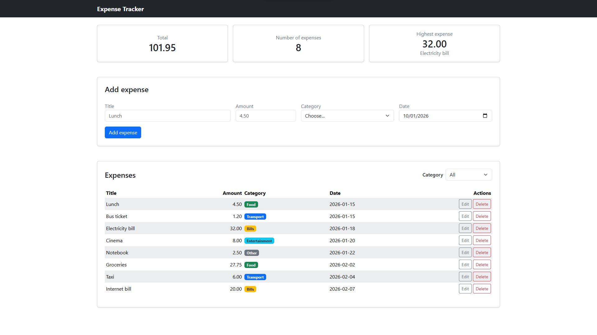

---

## Mobile

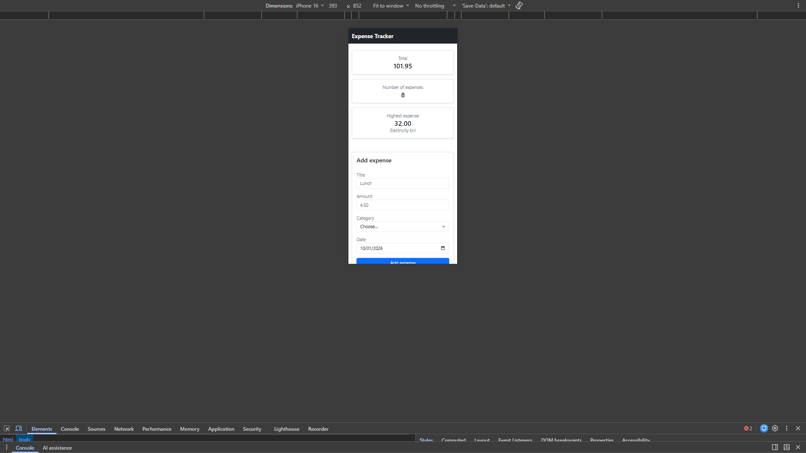

---

## Edit Expense Modal

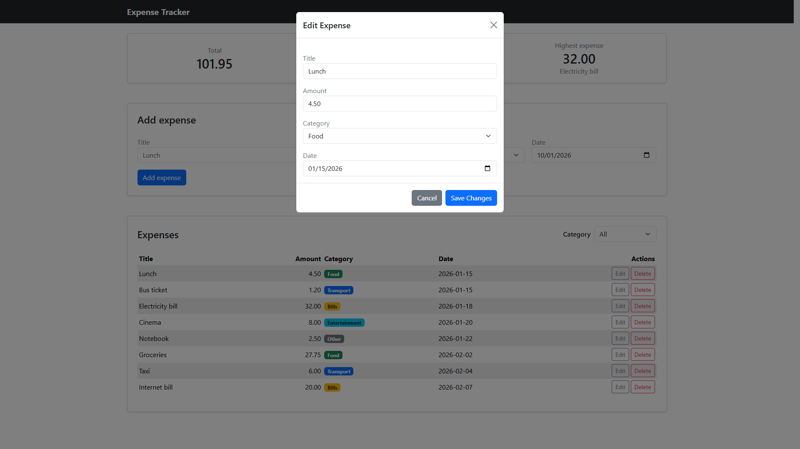

---

## Delete Confirmation Modal

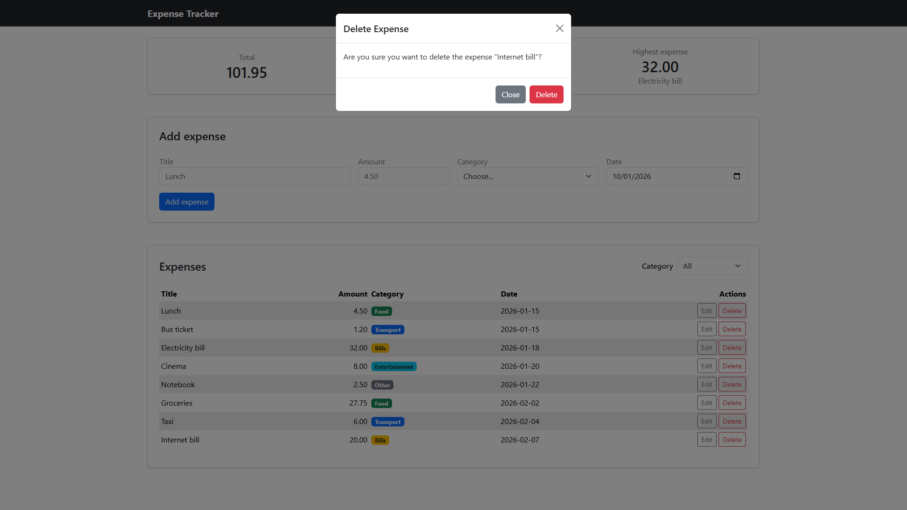

---

## Backend Connection Error

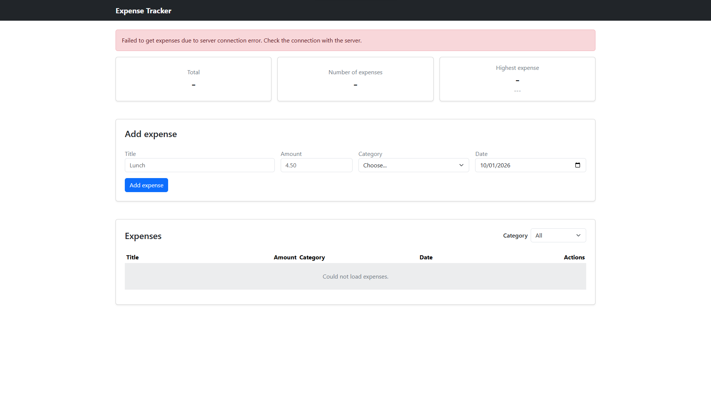

---

# API Testing Screenshots

## GET — All Expenses

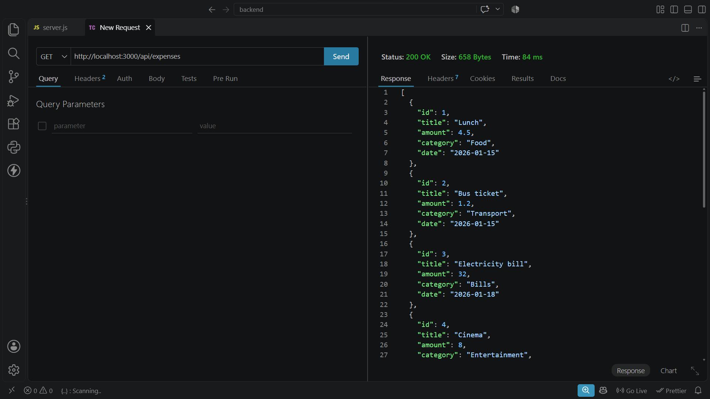

`GET /api/expenses` successfully returns the expenses list.

---

## GET — Expense by ID

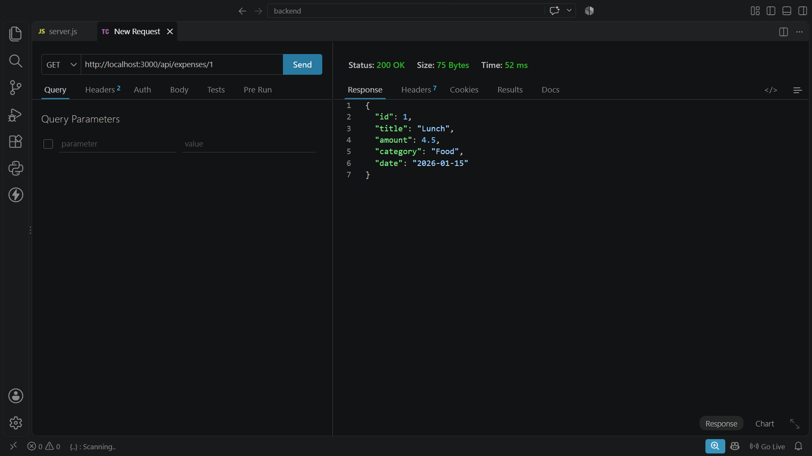

`GET /api/expenses/:id` successfully returns an existing expense.

---

## GET — Missing Expense


The API returns `404` when the requested expense does not exist.

---

## POST — Create Expense

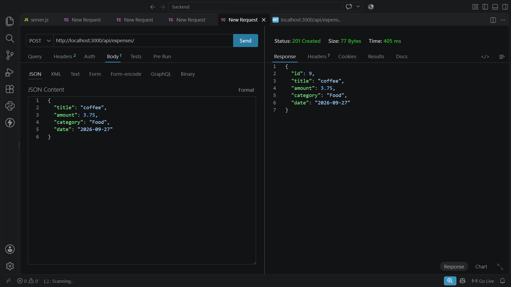

`POST /api/expenses` successfully creates a new expense.

---

## POST — Invalid Data

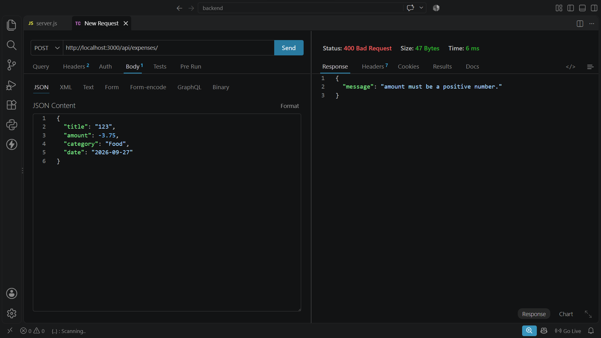

Invalid expense data returns `400 Bad Request`.

---

## PUT — Update Expense

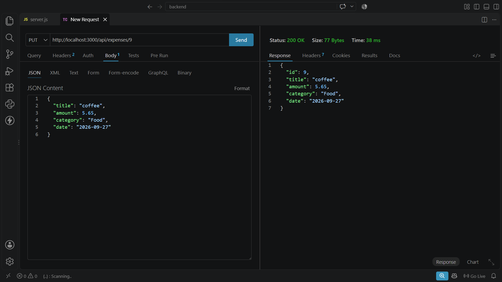

`PUT /api/expenses/:id` successfully updates an expense.

---

## PUT — Invalid Data


Invalid update data returns `400 Bad Request`.

---

## PUT — Missing Expense

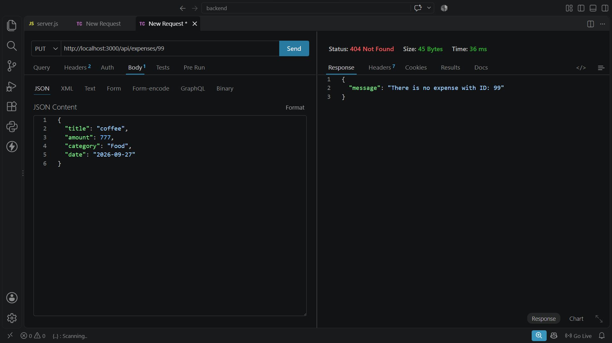

Updating a non-existing expense returns `404 Not Found`.

---

## DELETE — Expense

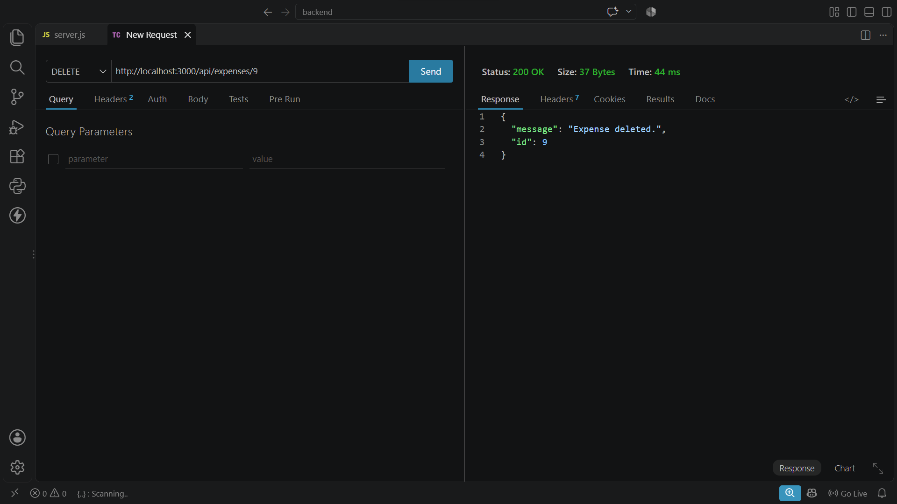

`DELETE /api/expenses/:id` successfully deletes an expense.

---

## DELETE — Missing Expense

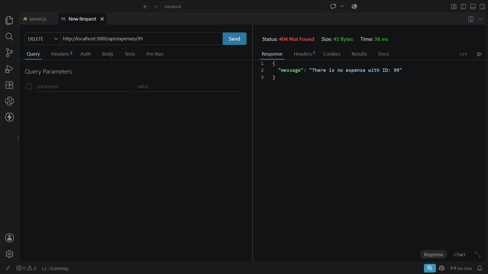

Deleting a non-existing expense returns `404 Not Found`.

---

# Challenges and Lessons Learned

## Backend

One of the important challenges was handling the difference between PostgreSQL data types and JavaScript values.

PostgreSQL `NUMERIC` values can be returned by `pg` as strings, while date values require careful handling when moving between PostgreSQL and JavaScript.

The API therefore explicitly converts the amount to a number and formats the date as:

```text
YYYY-MM-DD
```

Another important part was implementing validation before executing database queries.

The project uses shared validation functions for:

* IDs
* Titles
* Amounts
* Categories
* Dates

This keeps the validation behavior consistent between the `POST` and `PUT` endpoints.

Parameterized SQL queries were also used throughout the backend to keep user input separate from SQL statements.

---

## Frontend

The most challenging part of the frontend was handling different states of asynchronous API requests.

Each operation needs to handle:

```text
Loading → Success
        ↘ Failure
```

For example, while adding an expense:

```text
Add button
    ↓
Adding... + spinner
    ↓
API request
    ↓
Success → refresh → toast
    or
Failure → error alert
```

The `try/catch/finally` structure ensures that loading buttons are restored even when the request fails.

Another important challenge was keeping the frontend synchronized with the database.

Instead of manually adding, editing, or removing rows from the table after an operation, the application calls:

```javascript
refresh();
```

This retrieves the current data from the server and renders the interface again.

This means the server/database remains the source of truth.

---

# Security and Good Practices

Several good development practices were followed throughout the project.

### Parameterized SQL

The backend uses:

```sql
WHERE id = $1
```

instead of building SQL statements by concatenating user input.

### Environment Variables

Database credentials are stored in:

```text
.env
```

rather than directly inside the source code.

### No Sensitive Data in Git

The `.env` file should not be committed to GitHub.

### DOM Manipulation

Table rows are created using JavaScript DOM methods and user-provided values are inserted with:

```javascript
textContent
```

rather than:

```javascript
innerHTML
```

This prevents user-entered values from being interpreted as HTML.

### Server-Side Validation

Client-side validation improves the user experience, but the backend performs its own validation before writing to the database.

---

# Future Improvements

Possible future improvements include:

* User authentication.
* Multiple users with separate expense data.
* Pagination for large datasets.
* Expense categories managed dynamically from the database.
* Charts and visual analytics.
* Monthly expense reports.
* Budget tracking.
* Recurring expenses.
* Automated backend tests.
* Automated frontend tests.
* API documentation using Swagger/OpenAPI.
* Deployment to a cloud hosting platform.
* PostgreSQL migrations instead of resetting the database with `schema.sql`.

---

# Project Links

## GitHub Repository

The complete source code is available on GitHub:

https://github.com/HashemQuraan-402/expense-tracker-web-application

## Project Demo / Video

Project demonstration video:

https://drive.google.com/file/d/1YtRyQJT-hAmnteYnAEiXgx9OzPthImeC/view?usp=sharing

---

# Author

**Hashem Quraan**

Software Engineering — Jordan University of Science and Technology

GitHub:

https://github.com/HashemQuraan-402

---

# Final Notes

To run the application successfully, make sure that:

1. PostgreSQL is running.
2. The `expense_tracker` database exists.
3. `schema.sql` has been executed.
4. The backend `.env` file contains the correct PostgreSQL credentials.
5. Backend dependencies are installed.
6. `node server.js` is running.
7. The frontend is opened using Live Server.
8. The frontend `API_URL` points to the running backend.

The application uses PostgreSQL as the persistent source of truth, while the frontend communicates with it exclusively through the Express REST API.
